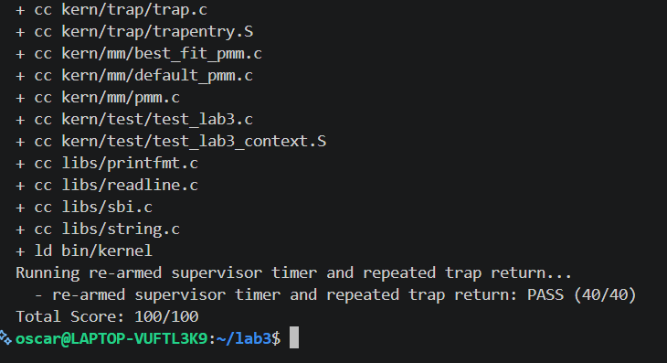

# 操作系统实验报告

## 实验基本信息

| 项目 | 内容 |
|------|------|
| **实验名称** | Lab 3: 中断处理机制——Trap 上下文保存/恢复与中断、异常处理 |
| **小组成员** | 2412412-郑志昊、2413498-陈梓轩、2412528-赵甫文  |
| **完成日期** | 2026-11-06 |

### 小组分工

练习如何分工？

| 成员 | 负责的练习/模块 |
|------|----------------|
| 2412412-郑志昊 | [功能模块1] |
| 2413498-陈梓轩 | [实验调试及全流程] |
| 2412528-赵甫文 | [功能模块2] |

---

## 一、实验目的

本实验的主要目的是：

1. 理解 RISC-V 的 Trap（中断与异常的统一抽象）机制，包括特权级切换、`stvec`/`sepc`/`scause`/`stval`/`sstatus` 等 CSR 在 Trap 发生时的硬件行为，以及 `sret` 的返回语义。
2. 掌握 Trap 前后上下文（context）的保存与恢复方法：以 `struct trapframe` 为数据载体，用 `SAVE_ALL`/`RESTORE_ALL` 两个对称的汇编宏完成寄存器与 CSR 的存取，并保证栈指针与 Trap frame 布局严格自洽。
3. 掌握汇编入口与 C 语言处理函数之间的衔接：按 RISC-V 调用约定把 Trap frame 作为第一个参数传给 `trap(struct trapframe *)`，并保证 `trap()` 返回后能进入统一的返回路径。
4. 学会处理最简单的两类 Trap：时钟中断（`IRQ_S_TIMER`，含重新装载下一次时钟事件、计数与统计输出）与断点异常（`CAUSE_BREAKPOINT`）、非法指令异常（`CAUSE_ILLEGAL_INSTRUCTION`，含按指令长度推进 `sepc`，避免异常循环）。
5. 学习使用 AI 辅助开发操作系统核心功能：通过迭代设计提示词（[RELY]/[GUARANTEE]/[SPECIFICATION] 三段式约束），让 AI 产出与既有工程代码严格一致的低层代码。

---

## 二、实验环境

| 成员 | AI 编程工具 | 底层模型 | 备注 |
|------|------------|---------|------|
| 2412412-郑志昊 | [Cline] | [DeepSeek-V4-Flash] | [无] |
| 2413498-陈梓轩 | [Codex] | [ChatGPT-5.6-sol] | [无] |
| 2412528-赵甫文 | [Pi] | [ChatGPT-6-Luna] | [无] |

---

## 三、实验整体逻辑分析

### 2.1 本章节的逻辑主线

本章围绕**"一个 Trap 从发生到返回的完整生命周期"**展开。操作系统是计算机系统的监管者，必须能对系统状态的突发变化（程序出错、外设请求、时间片到期）做出响应：暂停当前工作、进入内核处理、处理完再回到原处继续执行。

RISC-V 中"中断（异步、外部事件）"与"异常（同步、当前指令）"统称为 Trap。一次 Trap 的生命周期由三部分协作完成，这也正好构成本章的实验主线：

1. **硬件层**：Trap 发生时硬件自动"记账"——`sepc` 记录事发 PC、`scause` 记录原因、`stval` 记录附加信息、`sstatus` 保存 SIE→SPIE 与特权级 SPP——然后把 PC 置为 `stvec`。
2. **汇编入口层**（`kern/trap/trapentry.S`）：`stvec` 指向 `__alltraps`。它先用 `SAVE_ALL` 把 32 个通用寄存器与 4 个 CSR 保存成栈上的 `struct trapframe`，再把该帧的地址按调用约定传给 C 函数 `trap(tf)`；`trap()` 返回后由 `RESTORE_ALL` 反向恢复，最后 `sret` 完成返回。
3. **C 处理层**（`kern/trap/trap.c`）：`trap()` → `trap_dispatch()` 按 `scause` 最高位区分中断/异常，再分派给 `interrupt_handler()`（时钟中断等）与 `exception_handler()`（断点、非法指令等）。

因此本章的核心问题是：**如何让"保存—传递—处理—恢复—返回"五步之间在数据布局、调用约定、栈指针与 CSR 语义上完全自洽**。任何一处不一致（例如多恢复一个槽位、把 `sp` 当成普通寄存器读回、`epc` 推进量算错）都会表现为"能进不能出"或异常无限循环。

### 2.2 功能的逐步实现

本章按"先搭骨架、再填血肉"的顺序实现：

1. **首先实现 `RESTORE_ALL`（Trap 上下文恢复）** → 因为 `SAVE_ALL` 已经给出了"存"的方向，必须有与之严格对称的"取"才能形成闭环；否则 `trap()` 返回后无法回到被打断的执行流，后续所有功能都无法被观察和验证。这一步的关键是**照抄既有布局**，而不是自创布局。
2. **接着补全 `__alltraps` 中的调用衔接** → 上下文已能存取，但还需要把汇编世界与 C 世界连起来：把 Trap frame 地址放进 `a0`，用 `jal` 调用 `trap()`，并保证调用前后 `sp` 不变，使 `__trapret` 仍能从同一帧恢复。这一步把"能保存"升级为"能被处理"。
3. **然后实现 `interrupt_handler()`** → 有了完整闭环，才谈得上"处理什么"。最基础、最能验证闭环的是时钟中断：每次中断重新装载下一次时钟事件（否则只会收到一次中断），并递增 `ticks`，每 100 次输出一次统计。
4. **最后实现 `exception_handler()`** → 断点与非法指令异常是同步 Trap，处理完必须**推进 `sepc`**，否则 `sret` 会再次执行同一条异常指令，形成死循环。之所以放在最后，是因为它最直接地依赖前两步的正确性（尤其是 `RESTORE_ALL` 是否把 `sstatus`/`sepc` 等值正确写回 CSR，以及 `trap()` 返回后是否真的落回 `__trapret`）。

这个顺序符合"入口/返回基础设施 → 事件处理策略"的依赖关系，也与 `tools/grade.sh` 的三个测试（上下文与断点、非法指令、持续时钟中断）一一对应。

---

## 四、实验内容与实现

> 说明：本章实验手册只定义了**两个功能模块**（无额外的"练习"与 "Challenge" 环节），因此本部分按功能模块组织，小标题数量据此调整。

### 功能模块一：Trap 上下文恢复与 Trap 入口（`kern/trap/trapentry.S`）

**负责人：** [2412412-郑志昊]

#### 模块功能描述

**需要实现/修改的函数（汇编宏与标签）：**

```asm
# kern/trap/trapentry.S
    .macro RESTORE_ALL        /* 从栈上 Trap frame 恢复处理器状态 */
        ...
    .endm

    .globl __alltraps
__alltraps:
    SAVE_ALL                  /* 已提供：保存上下文到栈上的 Trap frame */
    /* 本模块补全：把 Trap frame 地址按调用约定传给 trap(tf) */
    mv a0, sp
    jal trap
    .globl __trapret
__trapret:
    RESTORE_ALL               /* 本模块实现 */
    sret                      /* 已提供：从 S 模式返回 */
```

**功能说明：**

本模块是整个 Trap 机制的"底座"，负责 Trap 从**进入内核**到**返回原执行流**之间的底层上下文管理。它不实现任何处理策略，只保证"状态进得来、出得去"。

- **`struct trapframe` 是唯一的数据契约。** 它由 36 个 `uintptr_t` 线性排列而成（RV64 下每槽 8 字节，共 288 字节）：偏移 0~31 依次对应 `x0`~`x31`，偏移 32~35 依次对应 `sstatus`、`sepc`、`stval`（旧名 `sbadaddr`）、`scause`。
- **`SAVE_ALL` 的既有行为决定了 `RESTORE_ALL` 必须怎么写**：
  - 先把原 `sp` 写进 `sscratch`，再 `addi sp, sp, -36*REGBYTES` 在栈上"让出"一个 frame；
  - 31 个通用寄存器用 `sd` 依次存入偏移 0~31，唯独 `x2(sp)` 特殊：它由 `csrrw s0, sscratch, x0` 从 `sscratch` 取回原栈指针后存入偏移 2，因此**偏移 2 里保存的是 Trap 发生瞬间的 `sp`**；
  - 4 个 CSR 通过 `csrr` 读入 `s1`~`s4` 后存入偏移 32~35。
- 因此 `RESTORE_ALL` 必须做到三件事：① 用 `s1`~`s4` 作临时寄存器把 4 个 CSR 从偏移 32~35 写回；② 恢复 `x1`、`x3`~`x31`（`x0` 恒为 0 无需恢复）；③ 用 `addi sp, sp, 36*REGBYTES` 把栈指针退回 frame 之前的位置，**而不是**从偏移 2 读回 `sp`。
- **`__alltraps` 的衔接**只需两条指令：`mv a0, sp`（第一个指针参数走 `a0`）与 `jal trap`。`jal` 会覆写 `ra`，但原 `ra` 早已存进槽 1，`RESTORE_ALL` 会把它重新载回，因此安全；`trap()` 作为普通被调函数按 ABI 保持 `sp`，所以返回后仍指向同一帧。

**实现结果（关键片段）：**

```asm
    .macro RESTORE_ALL
    #lab3 function1 YOUR CODE
    LOAD s1, 32*REGBYTES(sp)   # sstatus
    LOAD s2, 33*REGBYTES(sp)   # sepc
    LOAD s3, 34*REGBYTES(sp)   # stval
    LOAD s4, 35*REGBYTES(sp)   # scause
    csrw sstatus, s1
    csrw sepc, s2
    csrw stval, s3
    csrw scause, s4

    LOAD x1, 1*REGBYTES(sp)    # ra
    LOAD x3, 3*REGBYTES(sp)    # gp ... 依次到 x31
    ...
    LOAD x31, 31*REGBYTES(sp)

    addi sp, sp, 36 * REGBYTES # 与 SAVE_ALL 的 addi 严格对称
    .endm
```

**三个必须讲清的设计点：**

| 设计点 | 做法 | 若做错会怎样 |
|--------|------|--------------|
| CSR 与通用寄存器的先后 | **先**恢复 4 个 CSR（借 `s1`~`s4`），**后**恢复通用寄存器 | 反序时 `s1`~`s4` 已被内存值覆盖，写进 CSR 的就是错误的值 |
| 偏移 2（`sp`） | 不 `LOAD`，用 `addi sp, sp, +288` 回退 | 若 `LOAD sp, 2*REGBYTES(sp)`，`sp` 变成原栈指针，但会丢失 frame 基址、且与 `SAVE_ALL` 的 `addi` 不再对称，后续任何一帧访问都会错位 |
| `x0` | 不恢复 | 若从槽 0 `LOAD x0, ...`，汇编器虽接受但语义无意义；真正的约定是 `x0` 恒 0 |

`trap()` 返回后控制流顺序落入 `__trapret`，由 `sret` 依 `sepc`/`sstatus` 完成返回。

#### 最终提示词

以下是经过迭代优化后，最终成功实现该功能的提示词：

````markdown
**任务**：修改文件 `kern/trap/trapentry.S`，完成 Lab3 功能模块一：实现 `RESTORE_ALL` 宏，并补全 `__alltraps` 中 `SAVE_ALL` 之后、`__trapret` 之前的调用衔接代码。

**操作要求**：必须在项目中修改实际文件，而不是仅展示代码片段。保留文件中现有全部代码，尤其是已提供的 `SAVE_ALL`、`__trapret` 标签和 `sret` 指令；只在 `lab3 function1 YOUR CODE` 标记处补全实现。不得修改 `SAVE_ALL`、`struct trapframe` 定义与 `void trap(struct trapframe *tf)` 的函数签名，不得引入与本模块无关的功能。

**输出要求**：实现必须严格满足下面的 [RELY]、[GUARANTEE]、[SPECIFICATION]，以工程真实代码为准。

[RELY]
- `libs/riscv.h`：`#define STORE sd` / `#define LOAD ld` / `LOG_REGBYTES 3` / `#define REGBYTES (1 << LOG_REGBYTES)`（RV64 下 REGBYTES = 8）。
- `kern/trap/trap.h`：
  struct pushregs { zero, ra, sp, gp, tp, t0, t1, t2, s0, s1, a0..a7, s2..s11, t3..t6 }
  struct trapframe { struct pushregs gpr; status; epc; badvaddr; cause; }
  即 36 个 uintptr_t：偏移 0~31 → gpr，32 → status(sstatus)，33 → epc(sepc)，34 → badvaddr(stval)，35 → cause(scause)。
- Trap frame 与 SAVE_ALL 槽位的对应关系：偏移 0~31 对应 x0~x31；**偏移 2 保存的是 Trap 发生时的原 sp，其值来自 sscratch（SAVE_ALL 用 csrrw s0, sscratch, x0 取得），不是普通的 STORE x2**。
- 可用 CSR：sstatus / sepc / scause / stval；csrr rd, csr 读，csrw csr, rs 写；sret 由 `__trapret` 在 RESTORE_ALL 之后执行。SAVE_ALL 之后 sp 指向 Trap frame 起始。
- RISC-V 调用约定：第一个指针参数通过 a0 传递；`jal` 带返回地址跳转。

[GUARANTEE]
- `RESTORE_ALL`：进入时 sp 指向 Trap frame 起始；执行完毕时所有通用寄存器与 4 个 CSR 恢复为 Trap 发生时的值，sp 回到 Trap frame 之前的栈位置，随后可由 `__trapret` 执行 `sret`。
- `__alltraps` 衔接段：进入时 sp 指向 Trap frame 起始；执行后完成 `trap(tf)` 调用，`trap()` 返回后控制流进入 `__trapret`。
- 不得修改：`SAVE_ALL` 宏、`__alltraps` 中的 `SAVE_ALL` 调用、`__trapret` 标签及 `sret`、`struct trapframe`、`trap()` 签名。
- 可以添加：宏内部临时寄存器约定、仅在本模块内使用的偏移常量。

[SPECIFICATION]
## RESTORE_ALL
**Pre-Condition**：处于 S 模式 Trap 处理流程中，sp 指向由 SAVE_ALL 填好的 Trap frame 起始，36 个槽位均有效。
**Post-Condition**：4 个 CSR 已从偏移 32~35 恢复；通用寄存器 x1、x3~x31 已从偏移 1、3~31 恢复；x0 恒为 0 无需恢复；sp 已回退到 SAVE_ALL 中 `addi sp, sp, -36*REGBYTES` 之前的位置；宏执行完毕后处理器状态等价于 Trap 发生瞬间，可安全 `sret`。
**Case 1**：sp 指向合法 Trap frame 时，按偏移读 CSR 写回、按偏移读 x1/x3~x31 写回，随后用 `addi` 把 sp 调整回 frame 之前，控制流交回 `__trapret`。
**Requirements**：
- 必须与 SAVE_ALL 严格对称：偏移、槽位、寄存器一一对应，不得新增或遗漏槽位。
- 对 x2(sp) 的处理必须与 SAVE_ALL 的特殊处理呼应：不应把偏移 2 的内容当作普通寄存器 load 回 sp；sp 的恢复应通过调整栈指针实现，与 SAVE_ALL 的 `addi` 对称。
- 恢复 CSR 与通用寄存器的先后顺序、以及临时寄存器的使用，不得导致最终恢复值被自身覆盖。
- 不得破坏 `__trapret` 后续执行 `sret` 所需的状态。

## __alltraps 调用衔接段
**Pre-Condition**：已执行 SAVE_ALL，sp 指向完整 Trap frame 起始；尚未调用 C 处理函数。
**Post-Condition**：`trap()` 已被调用且参数 `tf` 等于 SAVE_ALL 后 sp 所指的 Trap frame 起始地址；`trap()` 返回后控制流进入 `__trapret`，此时 sp 仍指向该 Trap frame 起始（与调用前一致），Trap frame 内容未被破坏。
**Case 1**：按 ABI 把 Trap frame 起始地址放入 a0，跳转调用 `trap()`；返回后落到 `__trapret`。
**Requirements**：
- 传给 `trap()` 的指针必须是 SAVE_ALL 后 sp 所指的 Trap frame 起始地址，不得偏移或另建副本。
- 调用 `trap()` 前后 sp 必须一致（对应源码注释 "sp should be the same as before `jal trap`"），不得在调用前后额外压栈/弹栈。
- 使用 `jal` 或等效带返回地址的跳转，使 `trap()` 返回后能回到 `__trapret` 衔接处。
- 不得破坏 a0 之外 Trap frame 中保存的任何寄存器值。
- 不得修改 `trap()` 签名，不得在汇编中直接实现 `trap()` 的逻辑。
````

#### 实现迭代过程

本模块的实现经历了 **3** 次迭代，过程如下：

---

##### 第一次迭代：`RESTORE_ALL` 宏

**遇到的问题：**

- **问题 1：Trap frame 布局可能被"想当然"。** 若提示词只写"实现与 `SAVE_ALL` 相反的宏"，AI 很容易按"31 个通用寄存器 + 4 个 CSR 顺序倒着取"来写，而忽略 `SAVE_ALL` 中 `x0`、`x2` 的特殊处理，导致槽位整体错位一位。
- **问题 2：`sp` 的恢复方式。** 初版思路容易写成 `LOAD sp, 2*REGBYTES(sp)`，看起来"把原 sp 恢复回来了"，但这样会丢掉 frame 基址，且与 `SAVE_ALL` 的 `addi sp, sp, -36*REGBYTES` 不再对称——后续再取任何槽位都会错位。
- **问题 3：临时寄存器与恢复顺序冲突。** CSR 只能用通用寄存器中转，若先恢复 `x1`、`x3`~`x31`，再用 `s1`~`s4` 去写 CSR，写进 CSR 的就已经是"从内存读回来的新值"，而不是 Trap 时的 CSR 值（本质上还是对的，但一旦有寄存器被复用于中转就会出错）。

**问题解决策略：**

- 针对问题 1：在 [RELY] 中**贴出 `struct trapframe` 的真实字段顺序与偏移表**（0~31 → gpr、32 → status、33 → epc、34 → stval、35 → cause），并明确"偏移 2 存的是 `sscratch` 换出的原 sp"，把布局从"需要 AI 猜"变成"已被给定"。
- 针对问题 2：在 [SPECIFICATION] 的 Post-Condition 与 Requirements 中明确要求"sp 的恢复应通过调整栈指针回到 Trap frame 之前的位置实现，保证与 SAVE_ALL 的 `addi` 对称"，并显式禁止把偏移 2 当普通寄存器 load 回 `sp`。
- 针对问题 3：在 Requirements 中增加"恢复 CSR 与通用寄存器的先后顺序、临时寄存器的使用，不得导致最终恢复值被自身覆盖"，从而固定为"先借 `s1`~`s4` 写 CSR，再从内存恢复全部通用寄存器"的顺序。

**最终结果：** 宏按"CSR 在前、通用寄存器在后、`addi` 收尾"实现，并做了**逐槽静态审计**：`SAVE_ALL` 共用 36 个 `STORE`，`RESTORE_ALL` 用 34 个 `LOAD`（缺的正是槽 0 的 `x0` 与槽 2 的 `sp`），除这两个槽外每个偏移的寄存器名都与 `SAVE_ALL` 完全一致，`addi` 的 -288/+288 严格互逆。

---

##### 第二次迭代：`__alltraps` 的调用衔接

**遇到的问题：**

- **问题 1：** 传参必须是"SAVE_ALL 之后 sp 所指的同一地址"，不能借临时寄存器中转后再压栈，也不能做任何偏移。
- **问题 2：** 调用前后 `sp` 必须不变；若习惯性地在 `jal` 前后加 `addi sp, sp, -8` / `+8` 保存某些状态，`__trapret` 的 `RESTORE_ALL` 就会基于错误的 `sp` 恢复。
- **问题 3：** `jal trap` 会覆写 `ra`，需要确认这不会破坏返回路径。

**问题解决策略：**

- 针对问题 1、2：在 [SPECIFICATION] 中直接抄入源码注释 `sp should be the same as before "jal trap"`，并写明"调用前后 sp 必须保持一致，不得额外压栈或弹栈"，使约束与工程中的注释同源。
- 针对问题 3：在 [RELY] 中说明"`SAVE_ALL` 已把原 `ra` 存入槽 1，`RESTORE_ALL` 会重新载入"，从而明确"覆写 `ra` 是安全的"。

**最终结果：** 衔接段仅 `mv a0, sp` 与 `jal trap` 两条指令，`trap()` 返回后顺序落入 `__trapret`（`__trapret` 紧随其后，无需额外跳转）；`sp` 全程未变。

---

##### 第三次迭代：CSR 名称跟随新版工具链（`sbadaddr` → `stval`）

**遇到的问题：**

- 旧版 RISC-V 特权规范中的 `sbadaddr` 在新版工具链中已更名为 `stval`（同一 CSR，编号 0x143）。工程中 `SAVE_ALL` 与 `RESTORE_ALL` 原先都写作 `sbadaddr`，在较新工具链下会出现命名不匹配的告警/错误。

**问题解决策略：**

- 在提示词中明确"保留 `SAVE_ALL` 既有语义，仅统一 CSR 助记符"，并要求"`SAVE_ALL`/`RESTORE_ALL` 两处必须同时替换，保持入口与出口的对称性"；同时说明 `libs/riscv.h` 中的 `CSR_SBADADDR` 宏属 C 侧定义、不影响汇编，不作改动。

**最终结果：** `trapentry.S` 中三处 `sbadaddr` 全部改为 `stval`（`SAVE_ALL` 中的 `csrr s3, stval`、`RESTORE_ALL` 中的 `csrw stval, s3`、以及一处注释），CSR 编号与 trapframe 偏移均不变，行为等价。

**关键改进点总结：**

1. 在 [RELY] 中直接给出 trapframe 的**字段顺序与偏移表**，把"布局假设"从 AI 的自由度中移除。
2. 在 [SPECIFICATION] 中把 `x2(sp)` 的特殊性写成**显式禁令 + 对称性要求**，这是本模块最容易出错的点。
3. 明确了"临时寄存器可覆写、但必须在之后从内存重新载入"的顺序约束，避免自身覆盖。
4. 用源码注释原文（`sp should be the same as before "jal trap"`）作为衔接段的验收标准，使提示词与工程约束同源。

---

### 功能模块二：中断与异常处理（`kern/trap/trap.c`）

**负责人：** [2412528-赵甫文]

#### 模块功能描述

**需要实现/修改的函数：**

```c
void interrupt_handler(struct trapframe *tf);   /* 中断处理 */
void exception_handler(struct trapframe *tf);   /* 异常处理 */

/* 仅本文件内部使用的辅助实现 */
static uintptr_t trap_cause_code(struct trapframe *tf); /* 去掉 scause 最高位（中断标志） */
static void advance_epc(struct trapframe *tf);          /* 按指令长度推进 sepc */
```

**功能说明：**

本模块负责对 `trap_dispatch()` 分派过来的 Trap 做**具体分类与处理**，是"上下文闭环"之上真正的策略层。它与 `trapentry.S` 的分工是：汇编层只负责保存/恢复与传参，C 层只负责判断"这是什么 Trap、该怎么处理、返回后从哪里继续"。

- **中断处理 `interrupt_handler()`**：`scause` 最高位为 1 表示中断，但 `tf->cause` 中保留了这个高位，而 `libs/riscv.h` 里的 `IRQ_*` 宏是不带高位的编号（如 `IRQ_S_TIMER` = 5）。因此先由 `trap_cause_code()` 用 `tf->cause & ((uintptr_t)-1 >> 1)` 清掉最高位，再作比较。
  - **时钟中断（`IRQ_S_TIMER`）**：`clock_set_next_event()` 重新装载下一次时钟事件（这是"持续中断"的关键，不重新装载则只会收到一次），`ticks++`，每当 `ticks` 达到 `TICK_NUM`（100）的整数倍时输出统计：第一次调用已有的 `print_ticks()` 打印 `100 ticks`，其后打印 `ticks=200` 等。
  - **其他中断**：用 `switch` 覆盖 `libs/riscv.h` 中全部 `IRQ_*` 编号（软件/定时器/外设/协处理器等），输出对应类型提示。
  - **未识别中断**：打印 `Unknown interrupt: cause <n>`，并调用 `print_trapframe(tf)` 输出完整现场以便调试。
  - 不修改 `tf->epc`——中断是被打断指令的地址，返回后应继续执行该指令。
- **异常处理 `exception_handler()`**：`scause` 最高位为 0，`tf->cause` 即异常编号。
  - **非法指令（`CAUSE_ILLEGAL_INSTRUCTION` = 2）**：输出 `Illegal instruction at 0x<epc>`，然后推进 `epc`。
  - **断点（`CAUSE_BREAKPOINT` = 3）**：输出 `Breakpoint at 0x<epc>`，然后推进 `epc`。
  - **`epc` 的推进量不能写死**：RISC-V 支持压缩指令，指令长度可能是 2 字节或 4 字节。`advance_epc()` 读取 `epc` 处的半字，检查其低两位：`(insn & 0x3) == 0x3` 说明是 32 位及以上编码，`epc += 4`；否则是 16 位压缩指令，`epc += 2`。若推进量错误，`sret` 会再次执行同一条异常指令形成异常循环。
  - **其他异常**：不实现恢复逻辑，调用 `print_trapframe(tf)` 兜底。
- **与返回流程的衔接**：两个处理函数都是 `void` 返回，`trap_dispatch()` → `trap()` 返回后由 `trapentry.S` 的 `RESTORE_ALL` + `sret` 回到 `tf->epc` 处；因此处理函数**只能修改 `tf`（trapframe 内容）**，不能改动栈帧或返回路径。

#### 最终提示词

以下是经过迭代优化后，最终成功实现该功能的提示词：

````markdown
**任务**：修改 `kern/trap/trap.c`，实现中断与异常处理功能。

**操作要求**：在 `//lab3 function2 YOUR CODE` 标记处补全实现，保留现有代码，不修改函数签名、`trap_dispatch()`、`trap()` 或其他函数。处理函数返回后必须衔接现有 Trap 返回流程。

**输出要求**：直接修改项目文件，并确保实现符合以下 [RELY]、[GUARANTEE] 和 [SPECIFICATION]。完成后尝试使用 `make qemu` 验证；若构建或启动失败，检查并修正本任务涉及的代码及 Trap 入口字段兼容问题。

[RELY]

- `kern/trap/trap.h` 定义了 `struct trapframe`，包含 `uintptr_t epc` 和 `uintptr_t cause`。
- `kern/trap/trap.c` 已定义 `#define TICK_NUM 100`，并提供 `print_ticks()`；该函数输出 `100 ticks`，在 `DEBUG_GRADE` 下还会输出 `End of Test.` 并调用 `panic()`。
- `trap_dispatch(tf)` 已按 `tf->cause` 的最高位区分中断与异常，并分别调用两个处理函数；`trap()` 返回后由 `kern/trap/trapentry.S` 恢复 trapframe 并执行 `sret`。
- `kern/driver/clock.h` 声明 `extern volatile size_t ticks;` 和 `void clock_set_next_event(void);`。`kern/driver/clock.c` 中 `clock_set_next_event()` 会安排下一次时钟事件。
- `libs/riscv.h` 定义 `IRQ_S_TIMER`（值为 5）、`CAUSE_ILLEGAL_INSTRUCTION`（值为 2）、`CAUSE_BREAKPOINT`（值为 3），以及其他异常原因宏。
- `libs/sbi.h` 声明关机接口 `void sbi_shutdown(void);`。
- 当前工程没有定义 `SHUTDOWN_AFTER`。参考 `tools/grade.sh` 的预期（要求出现 `100 ticks` 和 `ticks=200`），在 `trap.c` 中以局部宏或常量明确关机阈值，达到累计 200 ticks 时关机。
- 兼容性注意：`kern/trap/trapentry.S` 使用 CSR 名 `stval` 保存 Trap 的异常值；`libs/riscv.h` 仍保留旧名 `sbadaddr`。不要为解决该名称差异而改动其他文件或新增不必要的 CSR 访问。

[GUARANTEE]

必须实现以下函数，签名保持不变：
```c
void interrupt_handler(struct trapframe *tf);
void exception_handler(struct trapframe *tf);
```
允许新增仅供 `trap.c` 内部使用的 `static` 辅助函数或局部常量；不得新增公开接口，也不得修改上述范围以外的函数。

[SPECIFICATION]

**`interrupt_handler(tf)`**
- 前置条件：`tf` 指向当前 Trap frame；`tf->cause` 表示中断。
- 对 supervisor timer interrupt（`IRQ_S_TIMER`），安排下一次时钟事件，每次中断将 `ticks` 增加一次。每当 `ticks` 达到 `TICK_NUM` 的整数倍，按要求输出统计信息；首次统计应包含现有 `print_ticks()` 的 `100 ticks` 输出，累计达到 200 ticks 时还应输出 `ticks=200` 并调用 `sbi_shutdown()`。
- 对其他可识别中断，输出对应类型提示；未识别中断调用 `print_trapframe(tf)`。
- 不修改 `tf->epc`，确保返回现有 Trap 返回流程。

**`exception_handler(tf)`**
- 前置条件：`tf` 指向当前 Trap frame；`tf->cause` 表示异常。
- 对 `CAUSE_ILLEGAL_INSTRUCTION`，输出以 `Illegal instruction at` 开头的提示，并在处理后推进 `tf->epc`，避免返回时重复执行该指令。
- 对 `CAUSE_BREAKPOINT`，输出以 `Breakpoint at` 开头的提示，并在处理后推进 `tf->epc`，避免返回时重复触发断点。
- 推进 `epc` 时依据 RISC-V 指令编码判断指令长度，不要假设所有指令固定为 4 字节；压缩指令为 2 字节，普通指令为 4 字节。
- 其他异常不实现恢复逻辑，调用 `print_trapframe(tf)` 作为兜底。
- 输出格式需兼容 `tools/grade.sh` 对 `Illegal instruction at` 和 `Breakpoint at` 的检查。

**共同要求**
- 保持中断/异常分类、处理行为、`tf->epc` 更新与 `sret` 返回行为一致。
- 除指定两个处理函数及必要的 `static` 辅助实现外，不修改 `trap.c` 中其他函数。
````

#### 实现迭代过程

本模块的实现经历了 **1** 次迭代，过程如下：

##### 第一次迭代：输出格式对齐评分脚本 / 关机行为

**遇到的问题：**

- **问题 1：** `tools/grade.sh` 用 `grep -F` 精确匹配字符串（`Illegal instruction at`、`Breakpoint at`、`Supervisor software interrupt`、`Unknown interrupt: cause 15`、`cause    0x00000014`），提示信息措辞或空格稍有不符就会判负。

**问题解决策略：**

- 针对问题 1：在 [SPECIFICATION] 中把"输出格式需兼容 `tools/grade.sh` 的检查"写成硬性要求，并逐条列出必须出现的字符串前缀；对 `print_trapframe()` 的既有输出格式（`  cause    0x%08x`）不作改动。

**最终结果：** 时钟中断分支形如：

```c
if (cause == IRQ_S_TIMER) {
    clock_set_next_event();
    ticks++;
    if (ticks % TICK_NUM == 0) {
        if (ticks == TICK_NUM) {
            print_ticks();              /* 输出 "100 ticks" */
        } else {
            cprintf("ticks=%d\n", (int)ticks);   /* 输出 "ticks=200" ... */
        }
    }
    return;
}
```

**关键改进点总结：**

1. 把"`scause` 最高位"这一体系结构细节写进提示词，从源头避免 `IRQ_*` 匹配失败。
2. 用"指令长度由编码决定"替代"固定 +4"，杜绝压缩指令场景下的错位返回。
3. 区分"首个统计复用 `print_ticks()`"与"后续整百打印 `ticks=N`"，同时满足实验手册与评分脚本两套期望。

---

## 五、测试与验证

**测试机制说明：**

`make grade` 会依次完成：清理 → 把工程复制到 `/tmp/lab3_grade` → 运行 `tools/inject.py`（把 `tools/test_lab3.c`、`tools/test_lab3.h`、`tools/test_lab3_context.S` 复制进 `kern/test/`，并在 `kern_init()` 中注入三处测试调用）→ 执行 `tools/grade.sh`，分别以 `GRADE_LAB3_CONTEXT`、`GRADE_LAB3_ILLEGAL`、`GRADE_LAB3_TIMER` 三个宏重新构建并在 QEMU 中运行，用 `grep -F` 检查输出中的哨兵字符串，累计 100 分。

| 测试 | 宏 | 检查点（必须全部出现） | 分值 | 超时 |
|------|----|------------------------|------|------|
| Trap 入口、寄存器恢复与断点 EPC | `GRADE_LAB3_CONTEXT` | `[Test 1] Trap entry and breakpoint return: PASS`、`Breakpoint at` | 35 | 8 s |
| 非法指令 EPC 推进与返回 | `GRADE_LAB3_ILLEGAL` | `[Test 2] Illegal instruction return: PASS`、`Illegal instruction at`、`Supervisor software interrupt`、`Unknown interrupt: cause 15`、`cause    0x00000014` | 25 | 8 s |
| 持续时钟中断与重复 Trap 返回 | `GRADE_LAB3_TIMER` | `[Test 3] Sustained supervisor timer: PASS`、`100 ticks`、`ticks=200` | 40 | 30 s |

**测试截图：**


---

## 六、实验总结与收获

### 对操作系统的理解

**1. 本实验中的重要知识点与 OS 原理的对应关系**

| 本实验的知识点 | 对应的 OS 原理知识点 | 二者的含义、关系与差异 |
|----------------|----------------------|------------------------|
| `SAVE_ALL`/`RESTORE_ALL` 与 `struct trapframe` | 中断/异常处理中的上下文保存与恢复 | 原理教材常以"保护现场—恢复现场"泛泛描述；本实验把它落到"36 个固定槽位 + 两个严格互逆的宏"上。差异在于**原理不规定布局，而工程必须规定布局**，且布局一旦确定就成为汇编与 C 之间的硬契约 |
| `stvec` + `__alltraps` + `jal trap` | 中断向量与中断处理程序入口 | 原理讲"中断向量表把不同中断映射到处理程序"；本实验采用 **Direct 模式**（`stvec` 低两位为 00，所有 Trap 共用一个入口），再由软件 `scause` 二次分派。差异：没有硬件向量表跳转，分类工作全部落在 C 代码里 |
| `sepc`/`scause`/`stval`/`sstatus` | 中断现场记录、原因识别、状态字（PSW） | 原理中的 PSW 包含优先级、屏蔽字、模式位；RISC-V 把它拆成多个 CSR。差异：RISC-V 的 `SIE/SPIE/SPP` 由硬件在 Trap 时自动搬移，`sret` 时自动恢复，软件只需正确保存、写回整字 |
| `sscratch` 交换 + 偏移 2 存原 `sp` | 内核栈/用户栈切换与栈帧管理 | 原理讲"中断要切换到内核栈"；本实验用 `sscratch` 暂存用户 `sp`，再用 `csrrw ... , x0` 取回并顺带清零，为"判断 Trap 来自内核还是用户"留下判据。差异：lab3 全部发生在内核态，`sscratch` 作用有限，属"为后续进程实验预留" |
| `ticks` + `clock_set_next_event()` | 时钟中断、时间片与抢占式调度 | 原理讲"时钟中断驱动时间片轮转"；本实验只做到"计数 + 打印 + 重新装载"。差异：**没有调度器**（那是后续实验），因此时钟中断在这里只证明"可持续、可返回"，不产生进程切换 |

**2. OS 原理中很重要、但本实验没有对应上的知识点**

- **进程/线程与调度**：本实验有"时钟中断"，但没有 `task_struct`、就绪队列、时间片轮转与上下文切换（`switch_to`），中断处理完只是原样返回。
- **系统调用（`ecall`）的完整实现**：`scause` 有 `ecall` 相关原因码，但本实验未实现"取系统调用号 → 查表 → 执行内核服务 → 返回值写回"的路径；本实验只对异常做了"打印 + 推进 `sepc`"的处理，没有真正把 Trap 变成服务请求。
- **缺页异常与按需分页**：虽然有 `stval` 与缺页原因码，但本实验不做页面错误处理、不涉及页表修改与换页。
- **中断嵌套与中断优先级**：本实验在 Trap 期间硬件清零 `SIE`，处理函数中不再开中断，因此没有嵌套、抢占式中断与优先级仲裁。
- **多核（SMP）与并发**：单 hart 环境，"关中断即原子"成立；自旋锁、核间中断（IPI）、`mideleg`/`medeleg` 的细粒度委托均未涉及。
- **用户态特权级切换的完整闭环**：`sstatus.SPP`、`sret` 回到 U 模式的机制被讲解与使用，但 lab3 的 Trap 全部发生在 S 模式内部，没有真正的"U→S→U"往返。
- **设备驱动与 DMA/外部中断的具体处理**：`IRQ_S_EXT` 仅有提示输出，没有真实外设的中断服务流程。

### AI 协作开发的经验

1. **提示词的价值不在"描述做什么"，而在"消除歧义"。** 本实验两次最大的隐患——`RESTORE_ALL` 里 `sp` 该如何恢复、`interrupt_handler` 里 `scause` 最高位如何处理——都不是 AI"不会写"，而是信息不足时会填入看似合理却与工程不符的假设。把 `struct trapframe` 的偏移表、"`x2` 的值来自 `sscratch`"这类**工程事实**写进 [RELY]，比任何形容词都有效。
2. **[SPECIFICATION] 要写成"可验收的断言"，而不是"希望达到的效果"。** 例如"sp 回到 `SAVE_ALL` 中 `addi` 之前的位置""`100 ticks` 与 `ticks=200` 必须出现"这类表述，既能让 AI 一次写对，也让我们自己有了复核清单。直接引用评分脚本 `grep` 的字符串来定义输出格式，是本次最省力的技巧。
3. **[GUARANTEE] 的"不得修改"清单同样是提示词的一部分。** 低层代码最怕"顺手重构"：`SAVE_ALL` 与 `RESTORE_ALL` 必须成对、`trap()` 签名不能动、`print_trapframe()` 的输出格式不能美化——把这些写成显式禁令，能显著降低"改一处、崩一片"的概率。
4. **AI 产出必须逐行复核，尤其是"对称性"与"边界"。** 本次对 `trapentry.S` 做了逐槽对照（36 个 `STORE` vs 34 个 `LOAD`、`addi` 互逆），这类机械核对最适合交给脚本或 AI 辅助完成，但**判断"为什么可以少这两个槽"必须由人来做**。
5. **对"工具链/环境差异"要保持警惕。** `sbadaddr` → `stval` 的更名说明：同一份代码在不同版本工具链下可能表现不同。提示词里主动声明"本工程用 `stval`"，并要求"两处同时替换、保持对称"，比事后逐个报错去修要高效得多。

